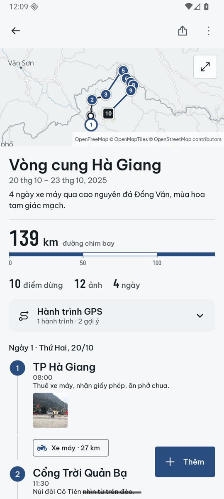

# Lữ Trình — nhật ký những cung đường

A travel journal app for Vietnam (Hà Giang loops, Ninh Bình river valleys, …). You create trips,
add the places you stopped at (steps) with a location picked on an OpenStreetMap map, a date, a
note and photos, and see the trip as a timeline and as a route on the map.

This repo holds the **native Android app** (Kotlin, Jetpack Compose, Material 3). An iOS
version in Swift/SwiftUI will follow; the platform-neutral spec it will be built from is in
[`docs/`](docs/README.md) (data model, screens, business rules, map, photos, iOS port mapping).

Current phase:

* All data stays on the device (SQLite via Room + photo files in app storage). No account, no
  server, no analytics. The only network traffic is OpenStreetMap tile downloads.
* UI language: Vietnamese.
* Flows were inspired by an analysis of a well-known travel-tracking app (see docs), with our own
  design, name, icon and copy.



## Build

Requirements: JDK 17, Android SDK with platform 35 (build-tools are fetched by Gradle).

```bash
export JAVA_HOME=/path/to/jdk-17            # e.g. /Library/Java/JavaVirtualMachines/temurin-17.jdk/Contents/Home
export ANDROID_HOME=/path/to/android-sdk    # or put sdk.dir=... in local.properties
./gradlew clean assembleDebug
# → app/build/outputs/apk/debug/app-debug.apk
```

Versions: Gradle 8.12 (wrapper), AGP 8.7.3, Kotlin 2.0.21, compileSdk/targetSdk 35, minSdk 26.
All library versions are in `gradle/libs.versions.toml`.

## Run

```bash
adb install -r app/build/outputs/apk/debug/app-debug.apk
adb shell am start -n vn.lutrinh.app/.MainActivity
```

In a debug build the empty trip list (and the ⋮ menu) offers **"Tạo dữ liệu mẫu"**, which adds two
sample trips (a Hà Giang loop and Ninh Bình) with generated pictures.

## Test

```bash
./gradlew testDebugUnitTest
```

JVM unit tests: validation (`ValidationTest`), ordering/route/stats/defaults (`OrderingTest`), use
cases with in-memory fakes (`UseCasesTest`) and the Room database incl. cascade deletes, run on
Robolectric with an in-memory database (`RoomRepositoryTest`), photo import sizing/orientation
(`PhotoImportPlanTest`). Reports: `app/build/reports/tests/testDebugUnitTest/index.html`.

Instrumented Compose UI tests (create / edit / delete a trip, add a step via a quick-place chip)
run on a connected device or emulator:

```bash
ANDROID_SERIAL=<device> ./gradlew connectedDebugAndroidTest
```

They clean up the trips they create (titles starting with `UITEST`). Report:
`app/build/reports/androidTests/connected/debug/index.html`.

## Photos

Picked photos are imported upright (EXIF orientation applied), downscaled to at most 2560 px on
the long edge (JPEG quality 85) and without GPS EXIF; small upright photos keep their bytes. See
[docs/06-photos.md](docs/06-photos.md).

## Project layout

```
app/src/main/java/vn/lutrinh/app/
  domain/      models, repository interfaces, validation, ordering, use cases (no Android types)
  data/        Room database, repositories, photo file store, sample data
  map/         MapConfig (tile URL, attribution, User-Agent), MapLibre setup and map views
  ui/          screens + view models (trips, steps, picker, photos, common, theme)
app/src/test/  JVM unit tests
app/src/androidTest/  instrumented Compose UI tests
app/schemas/   exported Room schema
docs/          platform-neutral spec + screenshots (docs/img)
```

## Map tiles

Tiles come from the OpenStreetMap community server configured in
`app/src/main/java/vn/lutrinh/app/map/MapConfig.kt` (`TILE_URL`). Public OSM tile servers are for
light use only: before a public release switch `TILE_URL` to a paid or self-hosted tile service.
See [docs/05-map.md](docs/05-map.md). Map data © OpenStreetMap contributors.
